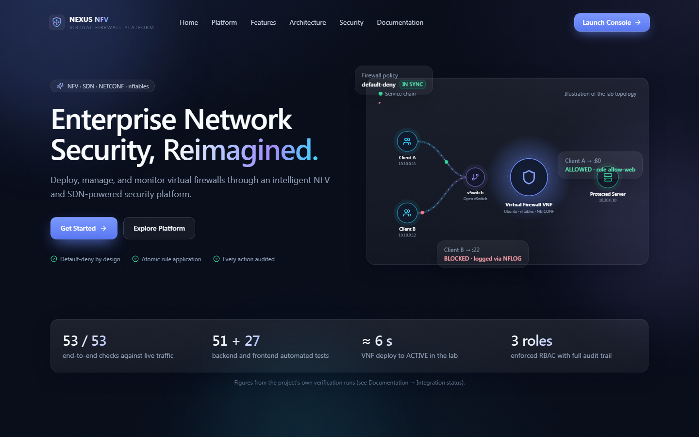
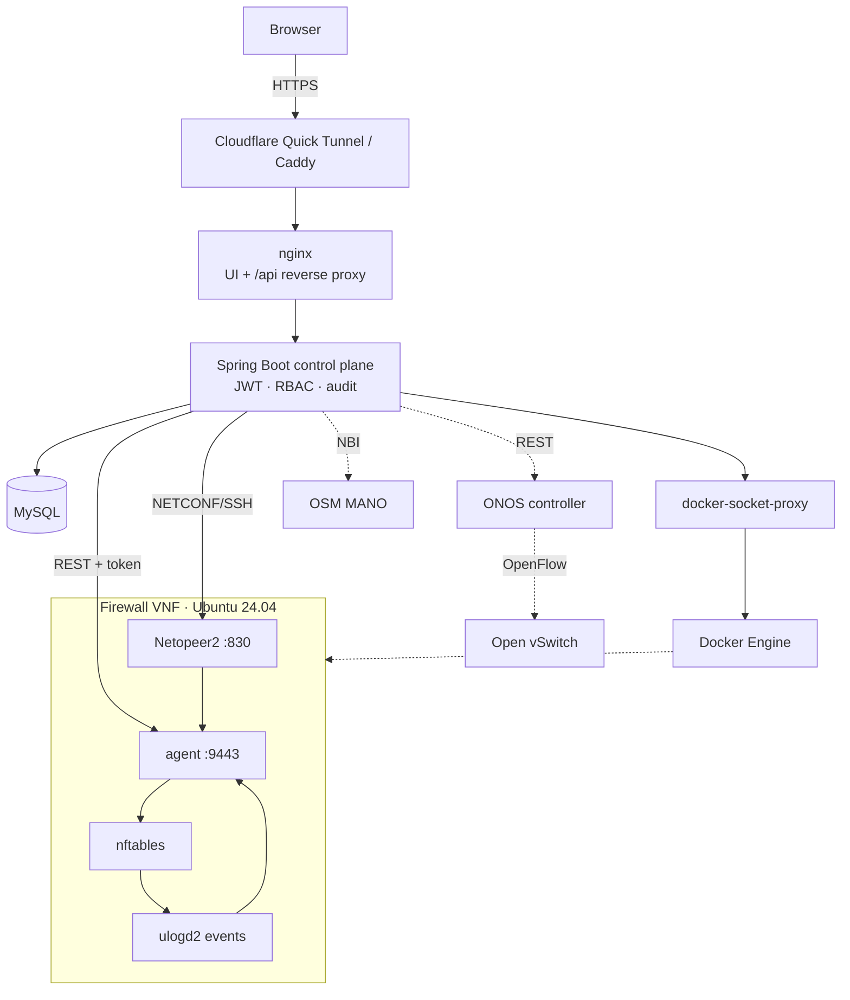
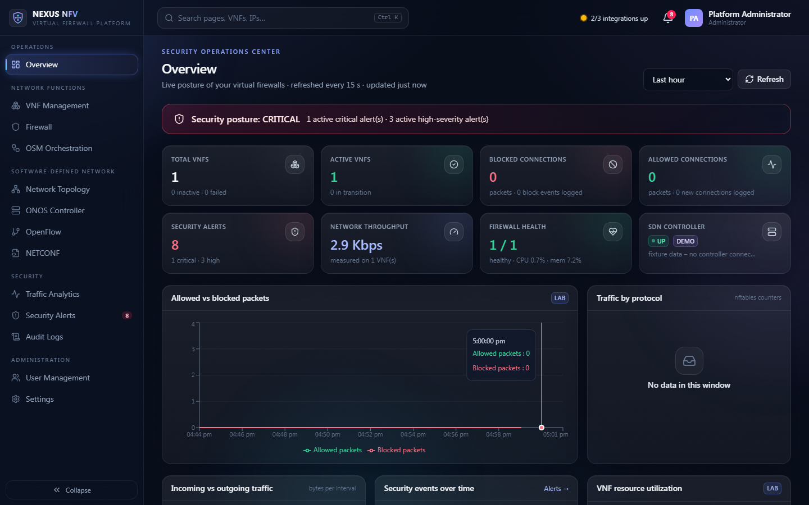
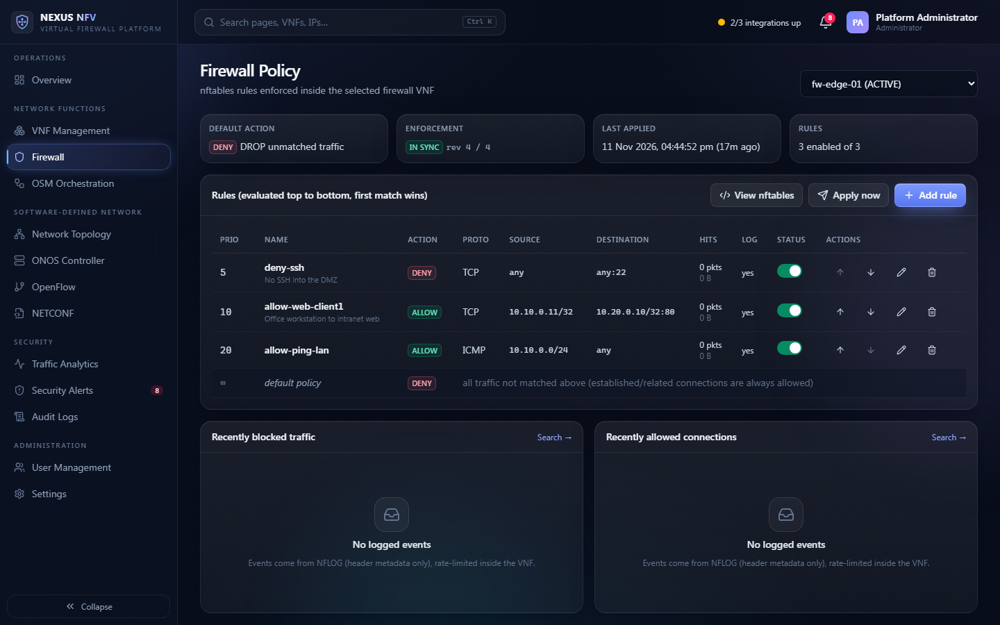
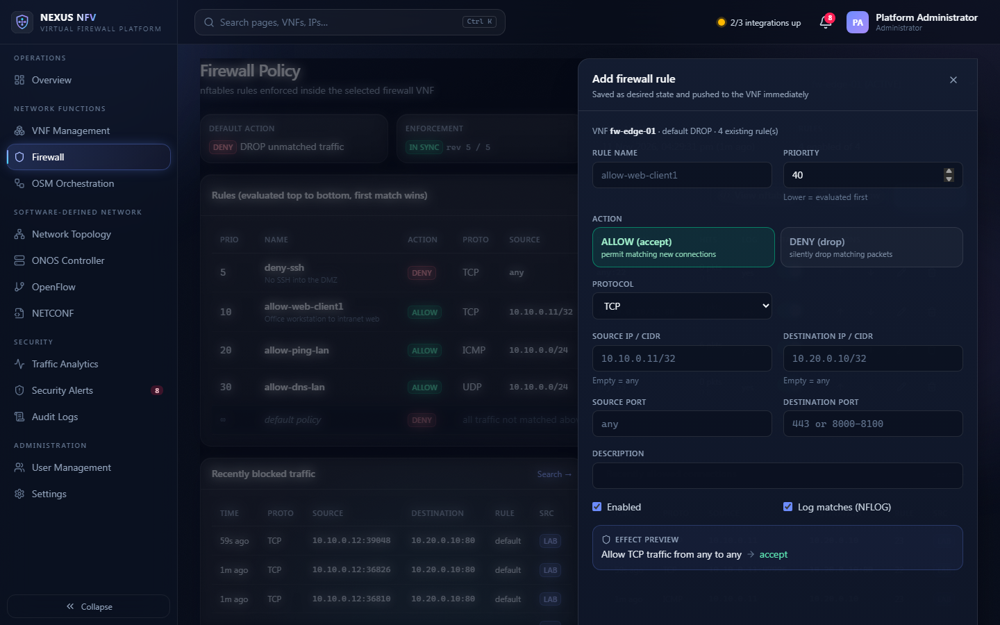
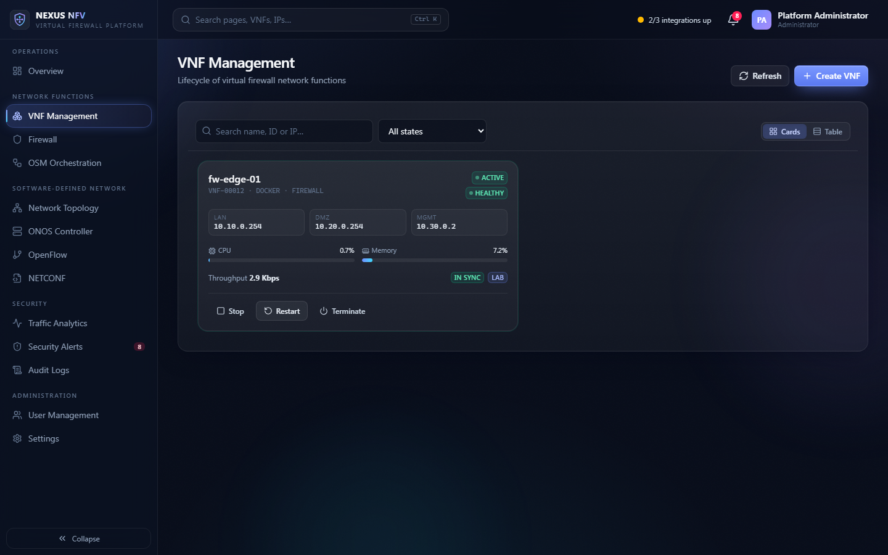
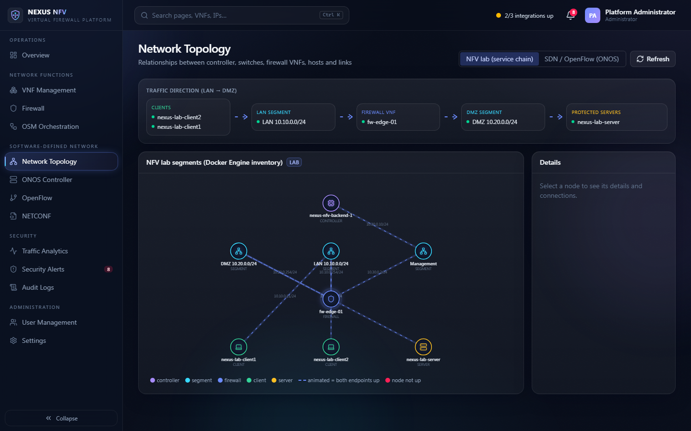
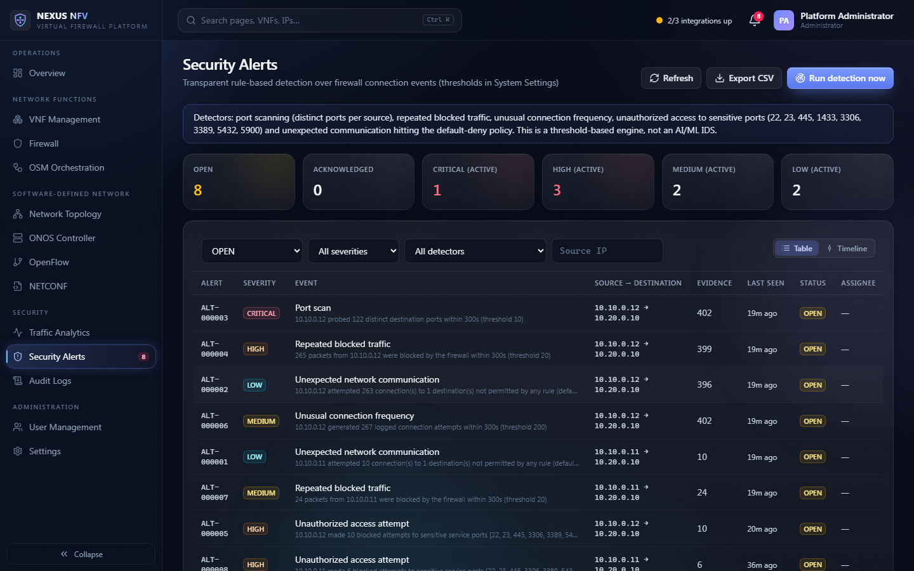
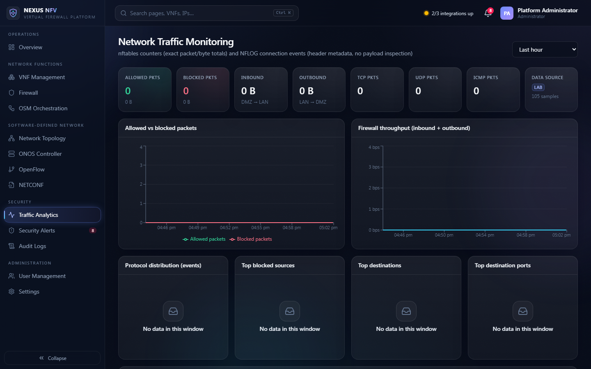
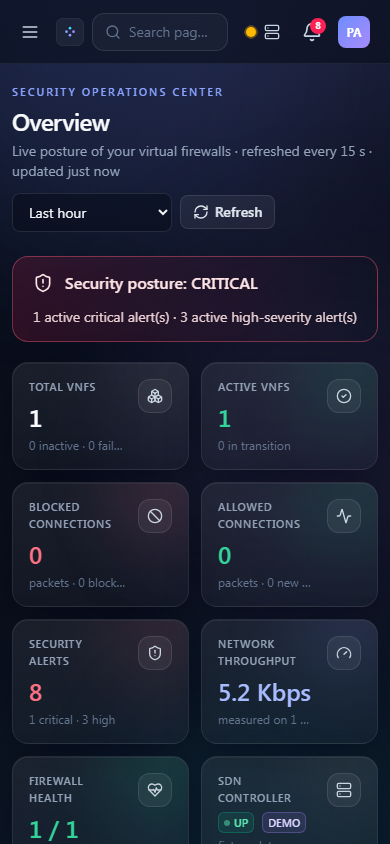

<div align="center">

# NEXUS NFV

### Enterprise Virtual Firewall Management Platform

**NFV-based virtual firewalls for small and medium enterprises — deploy, configure, monitor and govern
Ubuntu/nftables firewall VNFs from one secure console, with SDN (ONOS/OpenFlow), NETCONF and OSM integration.**

[](https://github.com/BSravanasree/NFV-Based-Virtual-Firewall-for-Enterprise-Security/actions/workflows/ci.yml)




</div>

---

## Live demonstration

> **Public demo (temporary):** https://fixtures-techrepublic-watches-drill.trycloudflare.com
>
> This link is a free **Cloudflare Quick Tunnel** to the developer's computer. It was verified working when this
> README was published, but it **changes every time the tunnel restarts** and is only reachable while that
> computer, Docker and the tunnel are running. If it does not open, the demo is temporarily offline — run it
> yourself in a few minutes with the [quick start](#local-installation). Demo credentials are shared on request;
> they are never published in this repository.

---

## Contents

[Overview](#overview) · [Problem statement](#problem-statement) · [Features](#features) · [Technology stack](#technology-stack) ·
[Architecture](#architecture) · [Network topology](#network-topology) · [Screenshots](#screenshots) ·
[Local installation](#local-installation) · [Windows setup](#windows-setup) · [Docker deployment](#docker-deployment) ·
[Public access (Cloudflare Quick Tunnel)](#public-access-cloudflare-quick-tunnel) · [Security](#security-considerations) ·
[Testing](#testing-results) · [API](#api-documentation) · [Limitations](#project-limitations) · [Author](#author-and-contributions)

## Overview

NEXUS NFV treats the firewall as a **Virtual Network Function**. An operator creates a firewall VNF, deploys it, and
manages its whole lifecycle from a web console. Firewall policy is defined centrally as *desired state* and
enforced inside each VNF as an atomic **nftables** transaction; the platform proves enforcement with exact kernel
counters and connection logs, detects attacks with transparent rules, steers traffic with **OpenFlow** policies
through **ONOS**, and manages configuration over **NETCONF** with a YANG model, versioning and rollback.

## Problem statement

Small and medium enterprises need flexible, affordable perimeter and segment firewalls. Hardware appliances are
costly, scale poorly and are configured box by box. NEXUS NFV replaces the appliance with software on commodity
compute (NFV), makes traffic steering programmable (SDN), and gives administrators one place to deploy, configure,
monitor and audit their firewalls.

## Features

| Area | Highlights |
|---|---|
| **Virtual firewall** | Ordered allow/deny rules by IP/CIDR, port/range and protocol (TCP/UDP/ICMP), priorities, enable/disable, default-deny, stateful (established/related), atomic `nft -f` apply, live ruleset view |
| **NFV lifecycle** | Create → deploy → start/stop/restart → scale → terminate through a state machine confirmed by the infrastructure (Docker lab or OSM); failures are reported, never faked |
| **SDN / OpenFlow** | ONOS devices, ports, hosts, links, flow tables; security policies compiled to OpenFlow 1.3 (drop, allow, forward, steer to firewall) |
| **NETCONF** | Netopeer2/sysrepo inside each VNF, YANG module `nexus-firewall`, validate/commit/rollback, configuration history, drift detection |
| **Monitoring** | nftables counters (allowed/blocked, protocol, direction), NFLOG connection events, top talkers, CSV export |
| **Threat detection** | Port scan, repeated blocks, brute force on sensitive ports, unusual frequency, unexpected flows — de-duplicated alerts with triage workflow |
| **Governance** | JWT + revocable sessions, 3 roles (Admin / Network Operator / Security Analyst), full audit trail, PDF security report |
| **Console UX** | Landing page, glass design system, global search (Ctrl K), notifications, responsive layout, every metric labelled `LIVE` / `LAB` / `DEMO` |

## Technology stack

| Layer | Technology |
|---|---|
| Frontend | React 18, TypeScript, Vite, Tailwind CSS 4, Recharts, Lucide, Axios, React Router |
| Backend | Java 17+, Spring Boot 3.5, Spring Security (JWT), Spring Data JPA, Flyway, springdoc-openapi |
| Database | MySQL 8.4 |
| Firewall VNF | Ubuntu 24.04, nftables, ulogd2 (NFLOG), Python agent, Netopeer2 + sysrepo (YANG) |
| Orchestration | Docker Engine API (local NFV lab), OSM NBI / SOL006 descriptors |
| SDN | ONOS 2.7 REST, OpenFlow 1.3, Open vSwitch, Mininet |
| Delivery | Docker Compose, nginx, Caddy (VPS), Cloudflare Quick Tunnel (free public demo), GitHub Actions CI |

## Architecture



Detailed design: [docs/SYSTEM_ARCHITECTURE.md](docs/SYSTEM_ARCHITECTURE.md) · database: [docs/DATABASE_SCHEMA.md](docs/DATABASE_SCHEMA.md) ·
lifecycle: [docs/NFV_LIFECYCLE.md](docs/NFV_LIFECYCLE.md) · firewall: [docs/FIREWALL_IMPLEMENTATION.md](docs/FIREWALL_IMPLEMENTATION.md)

## Network topology

```
 client1 10.10.0.11 ─┐                                                    ┌─ server 10.20.0.10
                     ├─ LAN 10.10.0.0/24 ─ [ firewall VNF .254 | .254 ] ─ DMZ 10.20.0.0/24
 client2 10.10.0.12 ─┘          (nftables · agent · NETCONF)               (HTTP 80/8080, TCP 22/3306, UDP 5353)
                               management 10.30.0.0/24 ── backend 10.30.0.10
```

All LAN↔DMZ traffic is routed through the firewall VNF. The SDN lab (`lab/sdn/`) builds the same chain with two
Open vSwitch switches under ONOS control ([docs/OPENFLOW_INTEGRATION.md](docs/OPENFLOW_INTEGRATION.md)).

## Screenshots

| Security operations overview | Firewall policy |
|---|---|
|  |  |
| **Rule editor (side panel)** | **VNF management** |
|  |  |
| **Network topology (service chain)** | **Security alerts** |
|  |  |
| **Traffic analytics** | **Mobile** |
|  |  |

## Local installation

Requirements: Docker 24+ with Compose v2 (Docker Desktop on Windows/macOS), 4 vCPU / 6 GB RAM for Docker.

```bash
git clone https://github.com/BSravanasree/NFV-Based-Virtual-Firewall-for-Enterprise-Security.git
cd NFV-Based-Virtual-Firewall-for-Enterprise-Security
cp .env.example .env                               # then set every secret (instructions inside)
docker compose --profile build build fw-vnf-image  # Ubuntu firewall VNF image (~10 min first time)
docker compose --profile lab up -d --build         # MySQL, API, console, lab clients + server
```

* Website: http://localhost:3000 · console: http://localhost:3000/overview (sign in as `admin` with `NEXUS_ADMIN_PASSWORD`)
* Swagger UI: http://localhost:8080/swagger-ui.html
* Walkthrough: [docs/DEMO_SCENARIO.md](docs/DEMO_SCENARIO.md)

## Windows setup

1. Install **Docker Desktop** (WSL 2 backend) and **Git for Windows**.
2. Clone the repository, copy `.env.example` to `.env` and fill in the secrets (PowerShell:
   `[Convert]::ToBase64String((1..32|%{Get-Random -Max 256}))` produces a valid `NEXUS_CREDENTIAL_KEY`).
3. Run the two `docker compose` commands above in PowerShell or Git Bash.
4. Optional public link: double-click **`start-nexus-public.bat`** (see below).

Line endings are enforced by `.gitattributes` (LF for scripts that run in Linux containers, CRLF for `.bat`/`.ps1`).

## Docker deployment

| Target | Command | Notes |
|---|---|---|
| Local / lab | `docker compose --profile lab up -d` | UI on :3000, API on 127.0.0.1:8080 |
| With ONOS | `docker compose --profile lab --profile sdn up -d` | set `NEXUS_ONOS_MODE=real` (~2 GB extra RAM) |
| Ubuntu VPS (permanent HTTPS) | `sudo ./deploy/deploy-ubuntu.sh` | Caddy + Let's Encrypt, only 80/443 published, runs the E2E suite against the public URL |

Details: [docs/DEPLOYMENT_GUIDE.md](docs/DEPLOYMENT_GUIDE.md).

## Public access (Cloudflare Quick Tunnel)

Free, no account, no domain, no VPS:

```text
start-nexus-public.bat     # starts Docker stack if needed, verifies health, downloads + signature-checks
                           # cloudflared, opens the tunnel to the nginx proxy and prints the verified URL
stop-nexus-public.bat      # stops only the tunnel – containers and data keep running
```

Architecture: `https://<random>.trycloudflare.com → cloudflared → nginx :3000 → UI + /api → Spring Boot → MySQL / VNFs`.
One hostname serves the website, console and API (no CORS needed). MySQL, the Docker socket, firewall agents and
NETCONF are never reachable through the tunnel. Plain HTTP is redirected to HTTPS.

## Security considerations

* Authentication: JWT (HS256) with server-side session revocation, BCrypt (cost 12), lockout after 5 failures,
  no default accounts — the first admin comes from `NEXUS_ADMIN_PASSWORD`.
* Authorization: role checks on every endpoint; verified that **all 87 API operations reject anonymous requests**.
* Input validation in the API **and** again in the VNF agent; rules are rendered from typed fields and applied
  without a shell.
* Secrets only in `.env` (git-ignored); NETCONF passwords encrypted with AES-256-GCM; nothing secret in the
  frontend bundle.
* Only the reverse proxy is published; the Docker socket is reachable only through a restricted proxy on an
  internal network.
* A quick-tunnel URL is public: treat it as exposure on the internet. Use strong passwords and a least-privilege
  demo account (`SECURITY_ANALYST`).

Run the audit yourself: `python lab/security_audit.py` (add `NEXUS_BASE=https://…` to audit a public URL).
Full model: [docs/SECURITY_DESIGN.md](docs/SECURITY_DESIGN.md).

## Testing results

Results of the latest verification run (Windows 11, Docker Desktop 29.4):

| Suite | Result |
|---|---|
| Backend — JUnit 5, Mockito, MockMvc integration (`mvn test`) | **51 / 51 passed** |
| Frontend — Vitest + React Testing Library (`npm test`) | **27 / 27 passed** · type check and production build clean |
| End-to-end — real VNF, real traffic, NETCONF, RBAC (`python lab/e2e_test.py`) | **53 / 53 passed** locally and **53 / 53 through the public Cloudflare HTTPS URL** |
| Security audit (`python lab/security_audit.py`) | **19 / 19 passed** locally and through the public URL |
| Browser verification through the public URL (Chromium, desktop + mobile) | 45 page loads, 620 requests: no CORS, mixed-content, console or 5xx errors |

How to run each suite: [docs/TESTING_GUIDE.md](docs/TESTING_GUIDE.md).

## API documentation

Versioned REST API under `/api/v1` with OpenAPI 3: Swagger UI at `/swagger-ui.html`, spec at `/v3/api-docs`
(every operation except login requires a bearer token). Reference: [docs/API_DOCUMENTATION.md](docs/API_DOCUMENTATION.md) ·
Postman collection: [docs/postman/NEXUS-NFV.postman_collection.json](docs/postman/NEXUS-NFV.postman_collection.json).

## Project limitations

* **OSM:** the NBI adapter and SOL006 packages are implemented but have not been run against a live OSM
  installation (it needs a dedicated VM and a VIM).
* **ONOS / OpenFlow:** the REST client is real; without a controller the console runs in an explicit **DEMO** mode
  with labelled fixture data. The Mininet/OVS lab needs an Ubuntu host with the openvswitch kernel module.
* **Public demo:** Cloudflare Quick Tunnels are temporary (new URL on every restart) and depend on the host
  computer staying online. For a permanent link use the Ubuntu VPS deployment.
* Detection is threshold-based (not machine learning); telemetry uses counters and packet headers (no payload
  inspection). IPv4 only.

More: [docs/TROUBLESHOOTING.md](docs/TROUBLESHOOTING.md).

## Author and contributions

**B Sravana sree** — final-year engineering project, *NFV-Based Virtual Firewall for Enterprise Security*.

Contributions are welcome: open an issue describing the change, then a pull request against `main`. CI must pass
(backend tests, frontend type check/tests/build, script checks). Never commit `.env` or credentials.

Released under the [MIT License](LICENSE).
