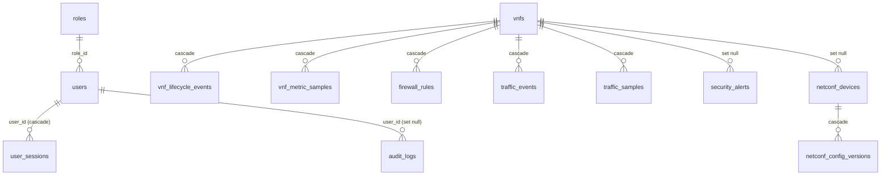

# Database Schema

MySQL 8.4, InnoDB, `utf8mb4`. Managed exclusively by **Flyway** (`backend/src/main/resources/db/migration`);
Hibernate runs with `ddl-auto: validate`, so the application refuses to start if the schema drifts.

| Migration | Content |
|---|---|
| `V1__baseline_schema.sql` | all tables, FKs, indexes, roles and default settings |
| `V2__netconf_host_key.sql` | SSH host-key pinning column for NETCONF devices |

## Entity relationships

Standalone tables: `network_devices`, `network_hosts`, `topology_links`, `network_policies` (SDN inventory
snapshots, keyed by controller id + data source), `controller_connections` (integration health),
`system_settings` (key/value with type).

## Tables

| Table | Purpose | Notable constraints / indexes |
|---|---|---|
| `roles` | ADMIN, NETWORK_OPERATOR, SECURITY_ANALYST | unique `name` |
| `users` | accounts, BCrypt hash, lockout counters | unique `username`, `email`; optimistic `version` |
| `user_sessions` | one row per issued JWT (`jti`) – enables logout/revocation | unique `jti`; idx `(user_id, expires_at)` |
| `audit_logs` | who did what, when, from where, outcome | idx `occurred_at`, `(username, occurred_at)`, `(action, occurred_at)` |
| `vnfs` | VNF aggregate: state, health, IPs, limits, desired vs applied policy revision, latest metrics | unique `name`; idx `state`; optimistic `version` |
| `vnf_lifecycle_events` | append-only lifecycle history (STARTED / SUCCEEDED / FAILED) | idx `(vnf_id, occurred_at)` |
| `vnf_metric_samples` | CPU / memory / throughput samples | idx `(vnf_id, sampled_at)` |
| `firewall_rules` | desired rules per VNF | unique `(vnf_id, priority)`, `(vnf_id, name)` |
| `traffic_events` | NFLOG header events | idx `occurred_at`, `(src_ip, occurred_at)`, `(vnf_id, occurred_at)` |
| `traffic_samples` | per-interval counter deltas | idx `sampled_at`, `(vnf_id, sampled_at)` |
| `security_alerts` | detector output + triage | idx `(status, severity)`, `(detector, source_ip, status)` (dedup), `last_seen` |
| `network_devices` / `network_hosts` / `topology_links` | SDN inventory snapshots | unique per controller id + `data_source` |
| `network_policies` | SDN policies and the ONOS flow id they were compiled to | unique `name` |
| `controller_connections` | last health probe of every integration | unique `(controller_type, name)` |
| `netconf_devices` | NETCONF endpoints; `password_enc` = AES-256-GCM ciphertext | unique `name`; FK `vnf_id` set null |
| `netconf_config_versions` | every push / rollback / snapshot with XML + canonical checksum | unique `(device_id, version_no)` |
| `system_settings` | detection thresholds, retention | PK `setting_key` |

## Data lifecycle

* Telemetry (`traffic_events`, `traffic_samples`, `vnf_metric_samples`) is purged after
  `retention.telemetry.days` (default 7); audit records after `retention.audit.days` (default 365).
* Expired sessions are purged hourly (kept 7 days after expiry for forensics).
* Deleting a VNF cascades to its rules, events, samples and lifecycle history; alerts and NETCONF devices
  are detached (FK set null) so security history is preserved.

## SQL injection protection

All access goes through JPA/JPQL with bound parameters or the Criteria API (dynamic filters in
`AuditService`, `TrafficService`, `AlertService`). No SQL is built by string concatenation.
