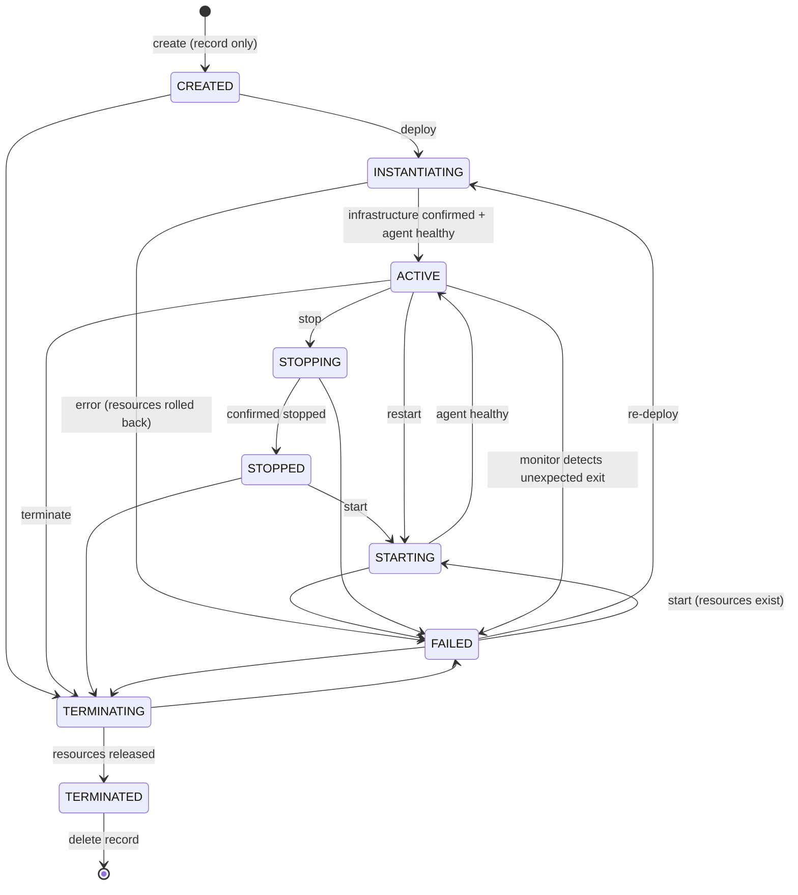

# NFV Lifecycle

## State machine

Defined in `vnf/VnfState.java` (`canTransitionTo`) and unit-tested in `DomainLogicTest.VnfStateMachine`.

## Operation semantics

| Operation | API | Allowed from | Transitional | Success | Confirmation required |
|---|---|---|---|---|---|
| Create | `POST /vnfs` | – | – | CREATED | none (record only; IPs validated against lab CIDRs) |
| Deploy | `POST /vnfs/{id}/deploy` → 202 | CREATED, FAILED | INSTANTIATING | ACTIVE | container running **and** agent `/health = ok` (lab) · NS LCM op `COMPLETED` (OSM) |
| Start | `POST /vnfs/{id}/start` → 202 | STOPPED, FAILED | STARTING | ACTIVE | agent healthy |
| Stop | `POST /vnfs/{id}/stop` → 202 | ACTIVE | STOPPING | STOPPED | container `Running=false` |
| Restart | `POST /vnfs/{id}/restart` → 202 | ACTIVE | STARTING | ACTIVE | agent healthy after restart |
| Configure | `PATCH /vnfs/{id}` | not transitional / terminated | – | unchanged | default-policy change is pushed to the VNF |
| Scale | `POST /vnfs/{id}/scale` | ACTIVE | – | ACTIVE | Docker `update` (vertical) · OSM scale / verticalscale op `COMPLETED` |
| Monitor | scheduled | ACTIVE | – | ACTIVE / FAILED | runtime status, agent health, resource usage |
| Terminate | `POST /vnfs/{id}/terminate` → 202 | CREATED, ACTIVE, STOPPED, FAILED | TERMINATING | TERMINATED | container gone (lab) · NS terminate `COMPLETED` (OSM) |
| Delete | `DELETE /vnfs/{id}` | CREATED, TERMINATED, FAILED w/o resources | – | removed | – |

### Engine (`VnfService.run`)

1. **Phase 1 (transaction):** validate transition, set transitional state, write `STARTED` lifecycle event.
2. **Phase 2 (lifecycle executor thread, security context propagated):** call the orchestrator. Calls block
   until the infrastructure confirms (polling container state / agent health / OSM LCM operation).
3. **Phase 3 (transaction):** success → final state + `SUCCEEDED` event + domain event (after commit);
   failure → `FAILED`, `last_error`, `FAILED` event, failed audit record.

There is no path that marks a VNF ACTIVE without a positive confirmation from the infrastructure.

## Orchestrators

| | Docker NFV lab (`NEXUS_ORCHESTRATOR_MODE=docker`) | OSM (`=osm`) |
|---|---|---|
| Unit of deployment | container `nexus-vnf-<name>` from `nexus/fw-vnf:1.0.0` | NS instance of `nexus_fw-ns` |
| Networks | `nexus-mgmt` (agent, NETCONF), `nexus-lan` 10.10.0.0/24, `nexus-dmz` 10.20.0.0/24 | NSD virtual links `mgmtnet`, `lannet`, `wannet` |
| Start/stop/restart | Docker API | NS `operate` (VDU `changeStateTo` start/stop) |
| Scaling | vertical (CPU quota / memory limit) | horizontal (`fw-scale-out` scaling aspect) and vertical (`verticalscale`) |
| Metrics | Docker stats (CPU %, memory, NIC bytes) → `LAB` | OSM MON / Prometheus (not polled by the platform); agent counters → `LIVE` |
| Safety | only touches containers labelled `nexus.vnf=true` and `nexus.vnf.id=<id>`; partial deployments are rolled back | NBI token auth; LCM operations awaited with timeouts |

## Health

| Health | Meaning |
|---|---|
| HEALTHY | runtime running, agent `ok`, nftables table present, applied revision = recorded revision |
| DEGRADED | agent reachable but nftables missing or revision mismatch (reconciler will re-apply) |
| UNREACHABLE | runtime running but agent not answering |
| UNKNOWN | not ACTIVE or orchestrator unreachable |
