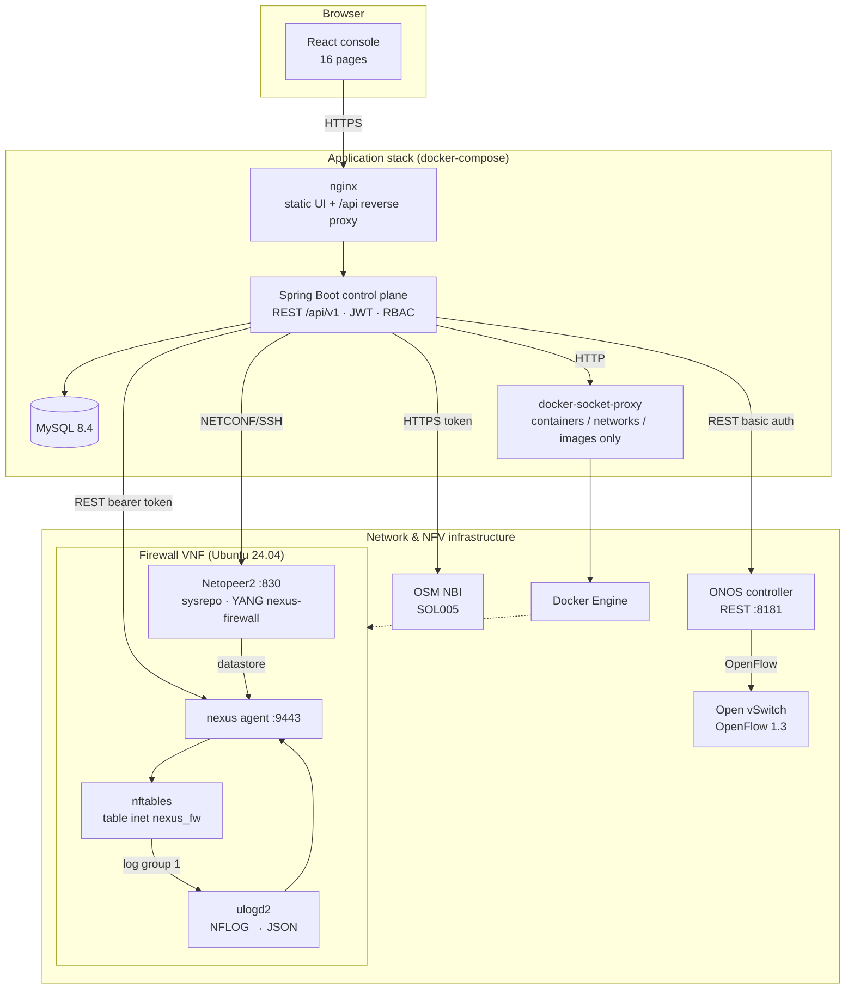
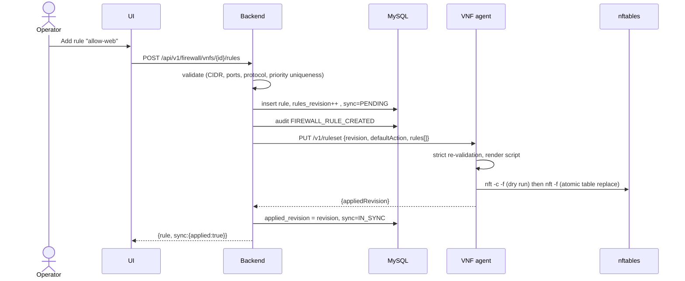

# System Architecture

## Component view

## Backend module structure (hexagonal / ports & adapters)

| Package | Responsibility | Ports → adapters |
|---|---|---|
| `security`, `auth`, `user` | JWT issuing/validation, sessions (revocable), lockout, RBAC, users | – |
| `audit` | audit trail (separate transaction), CSV export, PDF security report | – |
| `vnf` | VNF aggregate, lifecycle state machine, async lifecycle engine, monitor | `VnfOrchestrator` → `DockerLabOrchestrator`, `OsmOrchestrator` |
| `firewall` | rules (desired state), validation, sync/reconcile to the VNF | `FirewallAgentClient` |
| `traffic` | counter samples, NFLOG events, analytics, exports | `FirewallAgentClient` |
| `alert` | rule-based detection engine, alert triage | – |
| `sdn` | devices/hosts/links/flows, policy → OpenFlow compiler, topology graphs | `OnosGateway` → `RestOnosGateway`, `DemoOnosGateway` |
| `netconf` | device registry (encrypted credentials), push/validate/commit/rollback, drift | `NetconfSession` (MINA SSHD) |
| `integration`, `dashboard`, `settings` | health checks, posture aggregation, thresholds, retention | – |

Layering inside each module: **controller (DTO, validation, `@PreAuthorize`) → service (transactions,
business rules, audit) → repository (Spring Data JPA)**. External systems are only reached through the
adapter classes listed above, so REAL / LAB / DEMO implementations are swappable without touching services.

## Key flows

### Firewall rule change

If the agent is unreachable or rejects the ruleset, the rule stays saved (desired state), the VNF is marked
`FAILED` sync and the response says **not enforced**. A reconciler re-applies every 30 s.

### VNF deployment (lab)

`POST /vnfs/{id}/deploy` → state `INSTANTIATING` (committed) → lifecycle executor:
create container (labels, caps `NET_ADMIN`, limits, `ip_forward`) → attach LAN/DMZ networks with fixed IPs →
start → wait until agent `/health` is `ok` → record `ACTIVE` + external id → `VnfEvents.Activated`
(after commit) → initial policy push + NETCONF device auto-registration. Any failure → container removed,
state `FAILED` with the infrastructure error.

### Telemetry & detection

Every 10 s the collector reads `/v1/counters` (exact counters → per-interval deltas, rule hit counters) and
`/v1/events?since=` (NFLOG events) from each ACTIVE VNF. Every 15 s the detection engine evaluates
thresholds over the sliding window and creates or updates (de-duplicated) alerts.

## Communication & security boundaries

| From → To | Protocol | AuthN | Network |
|---|---|---|---|
| Browser → nginx | HTTPS (terminate at ingress) | – | edge |
| nginx → backend | HTTP | JWT bearer (per request) | edge |
| backend → MySQL | JDBC | user/password (env) | `app` (internal) |
| backend → docker-socket-proxy | HTTP | network isolation; proxy allows only container/network/image APIs | `control` (internal) |
| backend → VNF agent | HTTP (optional TLS) | shared bearer token, constant-time compare; input chain only allows the mgmt interface | `nexus-mgmt` (internal) |
| backend → Netopeer2 | NETCONF/SSH :830 | per-VNF random password (AES-GCM at rest), TOFU host-key pinning, NACM | `nexus-mgmt` |
| backend → ONOS | HTTP REST | basic auth (env) | edge |
| backend → OSM | HTTPS | token from `/admin/v1/tokens` | edge |

## Data provenance

Every infrastructure-derived record carries `dataSource` = `LIVE` (OSM-managed), `LAB` (local NFV lab) or
`DEMO` (fixture). The UI renders it as a badge; nothing derived from DEMO data is presented as measured.
